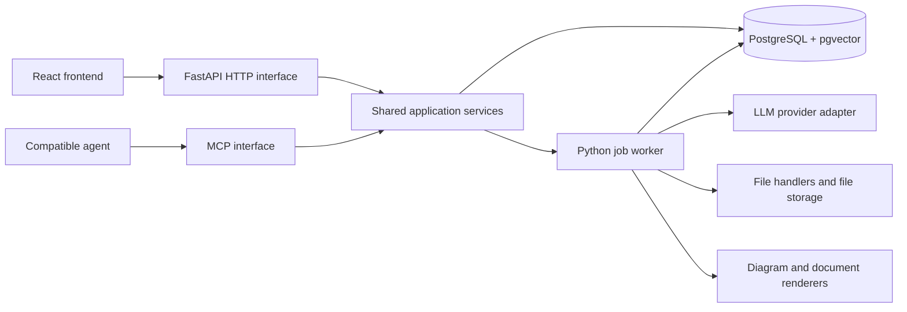

# Note Foundry

A personal knowledge bank that turns source material into clear, traceable notes, useful diagrams, and polished documents.

**Status: design starter.** This repository records the agreed architecture and development milestones. The application, handlers, database migrations, LLM integration, MCP server, and document templates are planned and are not implemented yet.

## Product goals

- Organise different subjects and purposes as projects with their own instructions, audience, input types, presentation preferences, and review rules.
- Import only the materials a project needs; no fixed transcript/PDF/code bundle is required.
- Explain concepts in plain language using small examples, suitable diagrams, exercises, and revision material when appropriate.
- Preserve source references and expose content, coverage, code, clarity, and presentation review findings.
- Keep notes editable and versioned. Export beautiful HTML/PDF documents from the approved content.
- Make the same knowledge and review capabilities available through a web interface and an MCP interface for compatible agents.

## Architecture

One repository with a React/TypeScript frontend and a modular Python/FastAPI backend. A worker runs durable processing jobs. PostgreSQL with pgvector stores application data, searchable source content, embeddings, versions, job state, and reusable processing results. File/object storage holds original files and generated assets.

The HTTP and MCP interfaces call the same application services. Generation jobs continue independently of an open browser. The backend owns access control, secrets, prompts, verification, and content versions.

## Project inputs

The creation screen lists formats from the implemented handler registry. A selection defines allowed inputs, not a requirement to supply every selected format. Settings can be changed later, with an explicit policy for already-imported files.

File type determines how an item is read. Its role determines how it is used: evidence, presentation reference, requirements, background, or content to improve. Project instructions determine the requested output.

Initial planned handlers: PDF, VTT/SRT, plain text/Markdown, Python files, Jupyter notebooks, and ZIP containers. Availability in the interface will reflect implemented capabilities, not this roadmap. DOCX, web imports, and media transcription can follow as separate handlers.

## First milestone

Create a project, configure its inputs and instructions, import a PDF and/or transcript, inspect extracted passages, and generate one beginner-friendly explanation with a diagram. Review the explanation against source evidence, inspect its rendered pages, and export a versioned PDF.

The first course pilot will use a locally supplied concurrency session. Teaching materials, reference PDFs, transcripts, generated private notes, and credentials are not included in this repository. Use synthetic fixtures for automated checks.

## Read next

- [Architecture and boundaries](docs/architecture.md)
- [Development roadmap](docs/roadmap.md)
- [Quality and review contract](docs/quality-contract.md)
- [Example project profile](examples/project-profile.json)
- [Contribution guidance](CONTRIBUTING.md)

There are no application run commands yet. The foundation milestone will add reproducible setup, dependency locks, migrations, and local startup commands.
